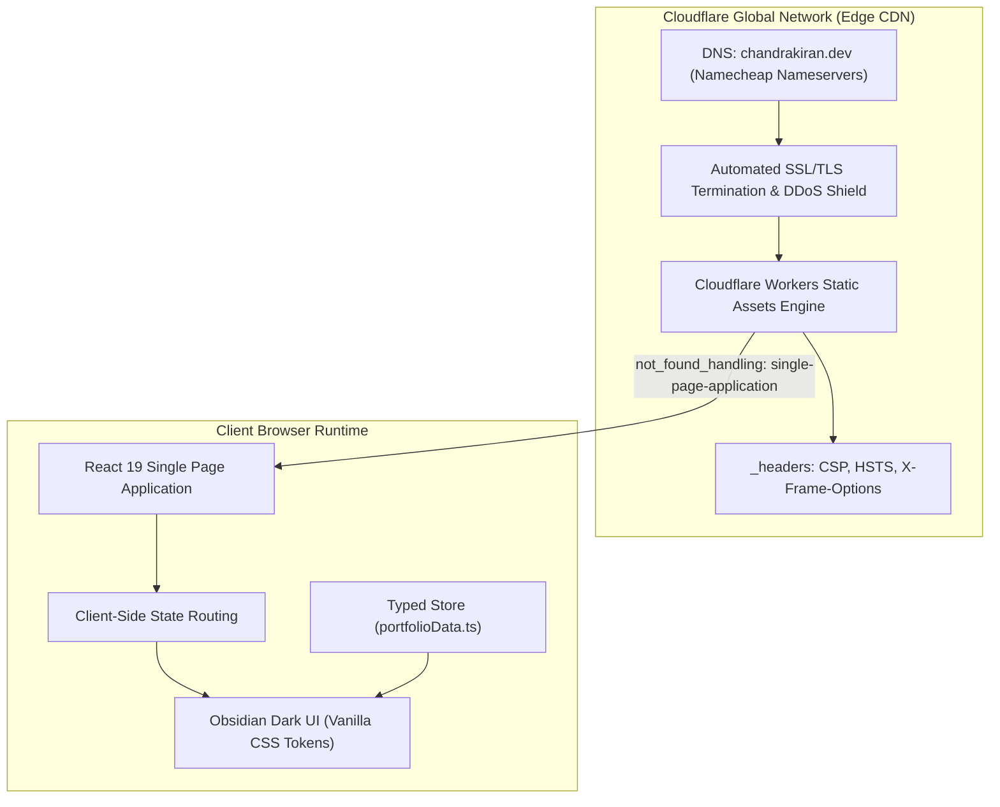

<div align="center">

# ⚡ Chandra Kiran Malkapuram
### **Cloud / DevOps & Applied AI Engineer**

<p align="center">
  <a href="https://chandrakiran.dev">
    
  </a>
  <a href="https://github.com/chandrakiranmalkapuram/chandra-kiran-portfolio">
    
  </a>
  <a href="https://www.linkedin.com/in/chandra-kiran-malkapuram/">
    
  </a>
</p>

<p align="center">
  
  
  
  
  
  
  
</p>

<p align="center">
  <strong>High-performance, obsidian-dark personal portfolio engineered for <a href="https://chandrakiran.dev">chandrakiran.dev</a>.</strong><br>
  Demonstrating resilient cloud-native architectures, conversational AI systems, and applied machine learning research.
</p>

---

[🌐 Live Deployment](https://chandrakiran.dev) • [💼 Featured Projects](#-featured-engineering-projects) • [🛠️ Architecture](#-system-architecture) • [🚀 Quick Start](#-local-development) • [📖 Deployment](#-cloudflare-deployment-workflow) • [📬 Contact](#-connect--contact)

---

</div>

## 📌 Executive Summary

This repository hosts the production codebase for **[chandrakiran.dev](https://chandrakiran.dev)**. It serves as an interactive showcase of production cloud engineering, automated CI/CD deployments, and enterprise AI integrations developed by **Chandra Kiran Malkapuram** (*MSc Cloud Computing at University of East London*).

### Core Highlights
* **Zero Bloat, High Velocity**: Engineered with **React 19**, **TypeScript**, and **Vite 8** using bespoke Vanilla CSS design tokens. No heavy CSS utility frameworks or render-blocking dependencies.
* **Obsidian Dark Aesthetic**: Carefully calibrated carbon/slate palette (`#0B0F17`) accented with electric cyan (`#06B6D4`) and deep indigo (`#6366F1`), featuring hardware-accelerated glassmorphism (`backdrop-filter: blur(12px)`).
* **Enterprise Cloudflare Workers Architecture**: Powered by Cloudflare Workers Static Assets with deterministic single-page application routing (`not_found_handling = "single-page-application"`) and automated edge header security.
* **Centralized Type-Safe Data**: Entire portfolio content (experience, projects, skills, and credentials) is strictly typed and decoupled in [`src/data/portfolioData.ts`](file:///Users/chandrakiran/.gemini/antigravity-ide/scratch/chandrakiran-dev/src/data/portfolioData.ts).
* **Inclusive by Design**: Fully WCAG AA contrast compliant, equipped with keyboard skip-to-content links, ARIA landmark semantics, and full support for `prefers-reduced-motion`.

---

## 💼 Featured Engineering Projects

The portfolio showcases five flagship projects spanning cloud infrastructure, conversational AI, and medical data science:

### 1. [Argos Check Character & Voice Confusion Risk Platform](https://github.com/chandrakiranmalkapuram/Argos-check-character)
> **Stack**: React 19 · TypeScript · Supabase PostgreSQL · Web Speech API · Vitest · Cloudflare Pages
* **Problem**: Voice-directed picking headsets in high-volume retail warehouse environments frequently suffer from acoustic confusion on damaged labels and phonetic similarity errors.
* **Solution**: Engineered dual Store (weighted ASCII modulo 26 mapped to NATO phonetics) and RFC calculation engines decoupled from the UI. Implemented an inverted index reverse lookup across 67,600 locations (00AA–99ZZ) and a community-driven Voice Confusion Risk reporting system backed by Supabase PostgreSQL with duplicate prevention.
* **Status**: [Live Demo](https://argos-check-character.pages.dev) • [GitHub Repository](https://github.com/chandrakiranmalkapuram/Argos-check-character)

---

### 2. [Retail AI Conversational Platform](https://github.com/chandrakiranmalkapuram/retail-ai-assistant)
> **Stack**: React · TypeScript · Node.js · Express · Google Gemini 2.5 Flash · OpenRouter
* **Problem**: Customer service staff are frequently pulled away from floor operations to manually cross-reference hardware compatibility and inventory.
* **Solution**: Developed a conversational retail assistant utilizing Google Gemini 2.5 Flash. Implemented an anti-hallucination prompt-builder grounding layer, hardware accessory matching engine, typing indicators, and local storage session continuity.
* **Status**: [GitHub Repository](https://github.com/chandrakiranmalkapuram/retail-ai-assistant)

---

### 3. [Intelligent Location Recovery Assistant](https://github.com/chandrakiranmalkapuram/Argos-check-character)
> **Stack**: System Design · React · FastAPI · PostgreSQL · Acoustic Confidence Scoring
* **Problem**: Misplaced stock caused by mistyped, misheard, or misremembered location codes disrupts warehouse fulfilment.
* **Solution**: Authored an architectural system design for a non-invasive read-only discrepancy recovery overlay using a 6-factor acoustic confidence ranking model to surface the most probable target locations without risking live inventory drift.
* **Status**: System Design Blueprint

---

### 4. [Diabetic Retinopathy Fused ML Framework](https://github.com/chandrakiranmalkapuram/A-Novel-Fused-Machine-Learning-Framework-For-Prediction-of-Diabetic-Retinopathy)
> **Stack**: Python · CNN · SVM · ANN · Fuzzy Fusion · GLCM · Scikit-Learn
* **Problem**: High inter-model variance in single-paradigm deep learning and classical classifiers during automated retinal image diagnosis.
* **Solution**: Constructed an automated medical image classification pipeline on the APTOS 2019 Kaggle dataset. Extracted Gray-Level Co-occurrence Matrix (GLCM) texture descriptors and synthesized CNN, SVM, and ANN predictions using fuzzy decision fusion to enhance generalization.
* **Status**: [GitHub Repository](https://github.com/chandrakiranmalkapuram/A-Novel-Fused-Machine-Learning-Framework-For-Prediction-of-Diabetic-Retinopathy)

---

### 5. [South Indian Temple Digital Invitation Platform](https://github.com/chandrakiranmalkapuram/Wedding-invitation-in-2-min)
> **Stack**: HTML5 · Modern CSS3 · Vanilla JavaScript · Canvas Pointer API · Web Audio
* **Problem**: Typical digital wedding invitations are static, bloated with third-party tracking scripts, and lack authentic cultural interaction.
* **Solution**: Hand-coded a zero-dependency, mobile-first experience capturing a traditional South Indian Hindu temple aesthetic. Features custom SVG architectural silhouettes, canvas scratch-to-reveal card mechanics, and autoplay-compliant ambient audio playback.
* **Status**: [Live Demo](https://chandrakiranmalkapuram.github.io/Wedding-invitation-in-2-min/) • [GitHub Repository](https://github.com/chandrakiranmalkapuram/Wedding-invitation-in-2-min)

---

## 🛠️ System Architecture



### Architectural Highlights
| Layer | Technology | Details |
| :--- | :--- | :--- |
| **Edge & CDN** | Cloudflare Workers Static Assets | Global low-latency CDN serving pre-compressed assets with HTTP/3. |
| **Routing** | Native Cloudflare SPA Handling | Zero redirect loops; `not_found_handling: "single-page-application"` in `wrangler.jsonc`. |
| **Security** | Cloudflare `_headers` | Strict `Content-Security-Policy`, `X-Frame-Options: DENY`, `HSTS`, `X-Content-Type-Options: nosniff`. |
| **Frontend** | React 19 + TypeScript | Concurrent rendering, typed state management, zero third-party UI framework overhead. |
| **Styling** | Vanilla CSS Design Tokens | HSL-driven variables for dark mode theme consistency, responsive CSS grid/flex layouts. |
| **Data Integrity** | TypeScript Interfaces | Compile-time validation of all project details, experience timelines, and skill levels. |

---

## 📂 Repository Structure

```
chandra-kiran-portfolio/
├── .github/                # CI/CD workflows and repository metadata
├── public/
│   ├── _headers            # Cloudflare security and asset caching policies
│   ├── favicon.svg         # High-resolution gradient monogram favicon
│   └── icons.svg           # Scalable vector graphics sprite map
├── src/
│   ├── assets/             # Vector branding assets & illustrations
│   ├── components/         # Modular, accessible React UI components
│   │   ├── Navbar.tsx      # Backdrop-blur sticky navigation with mobile drawer
│   │   ├── Hero.tsx        # High-impact hero section with dynamic status badges
│   │   ├── About.tsx       # Professional biography & core engineering competencies
│   │   ├── Projects.tsx    # Filterable showcase grid with detailed modal views
│   │   ├── Skills.tsx      # Categorized skill chips with proficiency indicators
│   │   ├── Experience.tsx  # Production work history timeline with quantifiable impact
│   │   ├── Education.tsx   # Academic background (MSc Cloud Computing & BTech CSE)
│   │   ├── Contact.tsx     # Direct contact cards with copy-to-clipboard interactions
│   │   ├── Footer.tsx      # Clean footer with quick links and copyright
│   │   └── Icons.tsx       # Reusable SVG icon components
│   ├── data/
│   │   └── portfolioData.ts # Centralized source of truth for all content
│   ├── styles/
│   │   └── portfolio.css   # Main stylesheet (design tokens, animations, layout)
│   ├── types/
│   │   └── index.ts        # Strict TypeScript type definitions
│   ├── App.tsx             # Root layout orchestrator
│   ├── index.css           # Global typography & baseline CSS resets
│   └── main.tsx            # React 19 DOM bootstrap
├── DEPLOYMENT.md           # Step-by-step production deployment & custom domain guide
├── package.json            # Project scripts, dependencies, and metadata
├── tsconfig.json           # Root TypeScript configuration
├── vite.config.ts          # Vite build & bundler configuration
└── wrangler.jsonc          # Cloudflare Workers static assets deployment manifest
```

---

## 🚀 Local Development

### Prerequisites
* **Node.js**: `v20.0.0` or higher recommended
* **Package Manager**: `npm` (v10+), `pnpm`, or `yarn`

### 1. Clone & Install
```bash
git clone https://github.com/chandrakiranmalkapuram/chandra-kiran-portfolio.git
cd chandra-kiran-portfolio
npm install
```

### 2. Launch Local Dev Server
```bash
npm run dev
```
Open **`http://localhost:5173`** in your browser. Vite Hot Module Replacement (HMR) will automatically update the browser as you edit.

### 3. Production Build & Validation
```bash
# Typecheck TypeScript & generate optimized bundle in dist/
npm run build

# Preview production bundle locally
npm run preview

# Run fast Oxlint static analysis
npm run lint
```

---

## ⚙️ Content Customisation Guide

Updating the portfolio requires zero modifications to JSX or layout code. Simply modify the typed configuration file:

👉 **[`src/data/portfolioData.ts`](file:///Users/chandrakiran/.gemini/antigravity-ide/scratch/chandrakiran-dev/src/data/portfolioData.ts)**

```typescript
// Example: Adding or modifying personal details
export const personalInfo: PersonalInfo = {
  name: 'Chandra Kiran Malkapuram',
  title: 'AI & Cloud / DevOps Engineer',
  badge: '📍 Greater London, UK · Open to Opportunities',
  domain: 'chandrakiran.dev',
  email: 'chandrakiranmalkapuram2000@gmail.com',
  // ...
};
```

Any changes made here are validated by the TypeScript compiler (`npm run build`) before deployment.

---

## ☁️ Cloudflare Deployment Workflow

This project is deployed to **Cloudflare Workers** with Static Assets:

```bash
# Build the production assets
npm run build

# Deploy directly via Wrangler
npm run deploy
```

### Automated GitHub CI/CD Deployment
1. Connect your GitHub repository (`chandrakiranmalkapuram/chandra-kiran-portfolio`) in the **Cloudflare Dashboard** under **Workers & Pages**.
2. Set the build configuration:
   * **Framework Preset**: `Vite`
   * **Build Command**: `npm run build`
   * **Build Output Directory**: `dist`
3. Cloudflare automatically triggers an edge deployment on every push to `main`.
4. Detailed DNS instructions for routing your **Namecheap** domain (`chandrakiran.dev`) via Cloudflare nameservers are documented in [`DEPLOYMENT.md`](file:///Users/chandrakiran/.gemini/antigravity-ide/scratch/chandrakiran-dev/DEPLOYMENT.md).

---

## ⚡ Performance, Security & Accessibility

* **Zero Third-Party CSS Overhead**: 100% bespoke Vanilla CSS tokens keep CSS bundle under 16 KB uncompressed.
* **Fast Edge Delivery**: Asset files are fingerprinted and served with `Cache-Control: public, max-age=31536000, immutable`.
* **Hardened Security Headers**:
  * `X-Frame-Options: DENY`
  * `X-Content-Type-Options: nosniff`
  * `Referrer-Policy: strict-origin-when-cross-origin`
  * `Permissions-Policy: camera=(), microphone=(), geolocation=()`
* **Accessibility (a11y)**:
  * Semantic HTML5 landmark structure (`<nav>`, `<header>`, `<main>`, `<section>`, `<footer>`).
  * Explicit keyboard navigation skip links.
  * Contrast ratios verified against WCAG AA standards.
  * Full respect for user motion preferences via `@media (prefers-reduced-motion: reduce)`.

---

## 📬 Connect & Contact

<div align="center">

| Channel | Link |
| :--- | :--- |
| **🌐 Production Portfolio** | [chandrakiran.dev](https://chandrakiran.dev) |
| **💼 LinkedIn** | [linkedin.com/in/chandra-kiran-malkapuram](https://www.linkedin.com/in/chandra-kiran-malkapuram/) |
| **🐙 GitHub** | [@chandrakiranmalkapuram](https://github.com/chandrakiranmalkapuram) |
| **📧 Direct Email** | [chandrakiranmalkapuram2000@gmail.com](mailto:chandrakiranmalkapuram2000@gmail.com) |
| **📍 Location** | Greater London, United Kingdom |

</div>

---

## 📄 License

This project is open-source and licensed under the [MIT License](LICENSE).

&copy; 2026 **Chandra Kiran Malkapuram**. All rights reserved.
