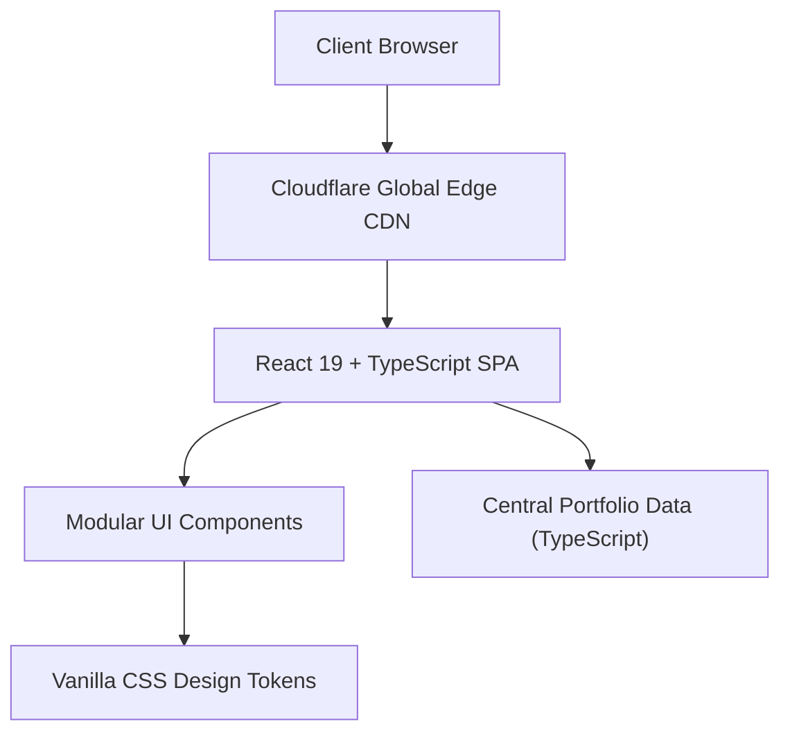

# ⚡ Chandra Kiran Malkapuram — Personal Portfolio

<p align="center">
  <a href="https://chandrakiran.dev">
    
  </a>
  <a href="https://github.com/chandrakiranmalkapuram/chandra-kiran-portfolio">
    
  </a>
  
  
  
  
</p>

<p align="center">
  A high-performance, dark-themed personal portfolio showcasing production cloud infrastructure, conversational AI systems, and machine learning research for <strong>Chandra Kiran Malkapuram</strong>.
</p>

---

## 📑 Table of Contents

- [Overview](#-overview)
- [Key Features](#-key-features)
- [Featured Projects](#-featured-projects)
- [Tech Stack](#-tech-stack)
- [Project Architecture](#-project-architecture)
- [Getting Started](#-getting-started)
- [Configuration & Customisation](#-configuration--customisation)
- [Deployment to Cloudflare Pages](#-deployment-to-cloudflare-pages)
- [Performance & Accessibility](#-performance--accessibility)
- [Contact & Connect](#-contact--connect)
- [License](#-license)

---

## 🌐 Overview

This repository powers **[chandrakiran.dev](https://chandrakiran.dev)**. It was built with modern web standards, featuring:

- **Obsidian Dark Aesthetic**: Deep carbon/slate palette accented with electric cyan (`#06b6d4`) and vibrant indigo (`#6366f1`).
- **Glassmorphic Cards**: Hardware-accelerated `backdrop-filter: blur(12px)` and delicate borders.
- **Zero Framework Overhead**: Styled completely with Vanilla CSS custom properties (design tokens) without heavyweight CSS utility frameworks.
- **Micro-Animations & Smooth Motion**: Hardware-accelerated transitions that gracefully degrade with `prefers-reduced-motion`.
- **Cloudflare Pages Optimized**: Includes custom routing headers (`_headers`) and SPA redirect rules (`_redirects`).

---

## ✨ Key Features

| Feature | Description |
| :--- | :--- |
| **Centralized Data Store** | All bio, projects, skill categories, work experience, and education are strictly typed in `src/data/portfolioData.ts`. |
| **Interactive Project Showcase** | Filterable project cards with modal details, technical highlights, live links, and GitHub repositories. |
| **Categorised Skills Grid** | Grouped by Cloud & Infrastructure, DevOps & Automation, AI/ML, Frontend, and Backend. |
| **Verifiable Experience Timeline** | Detailed breakdown of production achievements, including Azure, Docker, and CI/CD pipelines. |
| **Academic Background** | Highlights MSc in Cloud Computing at University of East London (UEL) and BTech in Computer Science. |
| **Accessible Navigation** | Semantic HTML5 structure, ARIA landmarks, keyboard skip links, and WCAG AA contrast compliance. |
| **Fast Build Times** | Instant HMR and sub-second production builds powered by Vite 8 and React 19. |

---

## 🚀 Featured Projects

### 1. [Argos Check Character & Voice Confusion Risk Platform](https://github.com/chandrakiranmalkapuram/Argos-check-character)
> **Stack**: React 19 · TypeScript · Supabase PostgreSQL · Web Speech API · Vitest
- High-volume warehouse stockroom verification engine for voice-directed picking headsets.
- Features dual Store (modulo 26 NATO phonetics) & RFC calculation engines, inverted index reverse lookup over 67,600 locations, and community acoustic risk reporting.
- **Live Demo**: [argos-check-character.pages.dev](https://argos-check-character.pages.dev)

### 2. [Retail AI Conversational Platform](https://github.com/chandrakiranmalkapuram/retail-ai-assistant)
> **Stack**: React · TypeScript · Node.js · Express · Google Gemini 2.5 Flash · OpenRouter
- Full-stack AI retail assistant resolving complex frontline product compatibility and stock inquiries.
- Includes a dedicated grounding prompt-builder layer to eliminate hallucination, typing indicators, and local storage session continuity.

### 3. [Intelligent Location Recovery Assistant](https://github.com/chandrakiranmalkapuram/Argos-check-character)
> **Stack**: System Design · React · FastAPI · PostgreSQL · Acoustic Scoring
- Comprehensive architectural blueprint for non-invasive discrepancy recovery in logistics warehouses using a 6-factor phonetic scoring algorithm.

### 4. [Diabetic Retinopathy Fused ML Framework](https://github.com/chandrakiranmalkapuram/A-Novel-Fused-Machine-Learning-Framework-For-Prediction-of-Diabetic-Retinopathy)
> **Stack**: Python · CNN · SVM · ANN · Fuzzy Fusion · GLCM · Scikit-Learn
- Medical machine learning pipeline evaluated on the APTOS 2019 dataset, combining heterogeneous classifiers via fuzzy logic fusion to reduce diagnostic variance.

### 5. [South Indian Temple Digital Invitation Platform](https://github.com/chandrakiranmalkapuram/Wedding-invitation-in-2-min)
> **Stack**: HTML5 · Modern CSS3 · Vanilla JavaScript · HTML5 Canvas · Audio API
- Zero-dependency interactive web invitation featuring authentic scratch-to-reveal canvas physics and ambient audio playback.
- **Live Demo**: [chandrakiranmalkapuram.github.io/Wedding-invitation-in-2-min](https://chandrakiranmalkapuram.github.io/Wedding-invitation-in-2-min/)

---

## 🛠️ Tech Stack



- **Runtime & Framework**: React 19, TypeScript 5.8
- **Tooling & Bundler**: Vite 8, Oxlint
- **Icons**: Lucide React + custom inline SVG monograms
- **Styling**: Vanilla CSS with HSL design variables
- **Hosting**: Cloudflare Pages with SSL/TLS and global edge caching
- **Domain**: `chandrakiran.dev` (registered on Namecheap, nameservers on Cloudflare)

---

## 📂 Project Architecture

```
chandrakiran-dev/
├── public/
│   ├── _headers            # Security headers (HSTS, CSP, X-Frame-Options) & asset cache rules
│   ├── _redirects          # SPA client-side routing fallback (/* /index.html 200)
│   ├── favicon.svg         # Modern gradient monogram favicon
│   └── icons.svg           # Scalable SVG sprite icons
├── src/
│   ├── assets/             # Static assets & illustrations
│   ├── components/         # Modular React components
│   │   ├── Navbar.tsx      # Fixed blur navbar with mobile menu
│   │   ├── Hero.tsx        # Hero banner with dynamic badges & CTA buttons
│   │   ├── About.tsx       # Bio summary & core competencies
│   │   ├── Projects.tsx    # Filterable project grid & modal deep dives
│   │   ├── Skills.tsx      # Technical skill badges grouped by category
│   │   ├── Experience.tsx  # Interactive work history timeline
│   │   ├── Education.tsx   # Degree, institution & module details
│   │   ├── Contact.tsx     # Direct contact cards with copy-to-clipboard
│   │   ├── Footer.tsx      # Minimal footer with quick links
│   │   └── Icons.tsx       # Reusable SVG icon components
│   ├── data/
│   │   └── portfolioData.ts # Typed source of truth for all content
│   ├── styles/
│   │   └── portfolio.css   # Main stylesheet (tokens, layout, components, responsiveness)
│   ├── types/
│   │   └── index.ts        # Comprehensive TypeScript interfaces
│   ├── App.tsx             # Root layout & active section state
│   ├── index.css           # Global reset & CSS variables
│   └── main.tsx            # React DOM bootstrap
├── DEPLOYMENT.md           # Step-by-step guide for Cloudflare Pages & Namecheap domain
├── package.json            # Scripts & project dependencies
├── tsconfig.json           # TypeScript configuration
└── vite.config.ts          # Vite build configuration
```

---

## 💻 Getting Started

### Prerequisites

- Node.js (version 20 or higher recommended)
- npm, pnpm, or yarn

### 1. Clone the repository

```bash
git clone https://github.com/chandrakiranmalkapuram/chandra-kiran-portfolio.git
cd chandra-kiran-portfolio
```

### 2. Install dependencies

```bash
npm install
```

### 3. Run development server

```bash
npm run dev
```

Open [http://localhost:5173](http://localhost:5173) in your browser. Hot Module Replacement (HMR) is active.

### 4. Build for production

```bash
npm run build
```

This compiles TypeScript and generates an optimized production distribution in the `dist/` folder.

### 5. Preview production build

```bash
npm run preview
```

### 6. Lint the codebase

```bash
npm run lint
```

---

## ⚙️ Configuration & Customisation

All portfolio content is decoupled from components. To update your information, simply edit:

👉 **[`src/data/portfolioData.ts`](file:///Users/chandrakiran/.gemini/antigravity-ide/scratch/chandrakiran-dev/src/data/portfolioData.ts)**

- **Personal Info**: Name, tagline, bios, social links, location, email.
- **Projects**: Add or edit projects, descriptions, tags, repo links, and live URLs.
- **Skills**: Add or modify skill categories, technical tags, and proficiency levels.
- **Experience**: Add new roles, company names, achievements, and technology tags.
- **Education**: Add degrees, institutions, graduation dates, and modules.

---

## 🚀 Deployment to Cloudflare Pages

This application is ready to deploy on **Cloudflare Pages** connected directly to your GitHub repository:

1. Log into your **Cloudflare Dashboard** and navigate to **Workers & Pages** > **Create application** > **Pages** > **Connect to Git**.
2. Select repository: `chandrakiranmalkapuram/chandra-kiran-portfolio`.
3. Configure build settings:
   - **Framework preset**: `Vite`
   - **Build command**: `npm run build`
   - **Build output directory**: `dist`
4. Click **Save and Deploy**.
5. Under **Custom domains**, add **`chandrakiran.dev`** and follow the automated DNS verification.

For comprehensive details on setting up DNS records on Namecheap and configuring Cloudflare nameservers, refer to the **[`DEPLOYMENT.md`](file:///Users/chandrakiran/.gemini/antigravity-ide/scratch/chandrakiran-dev/DEPLOYMENT.md)** guide.

---

## ⚡ Performance & Accessibility

- **Fast First Paint**: Zero render-blocking heavy CSS frameworks.
- **Responsive Layout**: Designed mobile-first, scaling fluidly to ultrawide desktop screens.
- **Accessibility**:
  - Semantic HTML5 landmark tags (`<header>`, `<main>`, `<section>`, `<footer>`, `<nav>`).
  - High-contrast color ratios meeting WCAG AA standards.
  - Skip navigation link for keyboard-only users.
  - Motion control honoring `prefers-reduced-motion: reduce`.
- **Security Headers**: Built-in `_headers` providing `Content-Security-Policy`, `X-Frame-Options: DENY`, `X-Content-Type-Options: nosniff`, and `Strict-Transport-Security`.

---

## 📬 Contact & Connect

- **Portfolio**: [chandrakiran.dev](https://chandrakiran.dev)
- **LinkedIn**: [linkedin.com/in/chandra-kiran-malkapuram](https://www.linkedin.com/in/chandra-kiran-malkapuram/)
- **GitHub**: [@chandrakiranmalkapuram](https://github.com/chandrakiranmalkapuram)
- **Email**: [chandrakiranmalkapuram2000@gmail.com](mailto:chandrakiranmalkapuram2000@gmail.com)
- **Location**: Greater London, United Kingdom

---

## 📄 License

This project is open-source and available under the [MIT License](LICENSE).

&copy; 2026 Chandra Kiran Malkapuram. All rights reserved.
